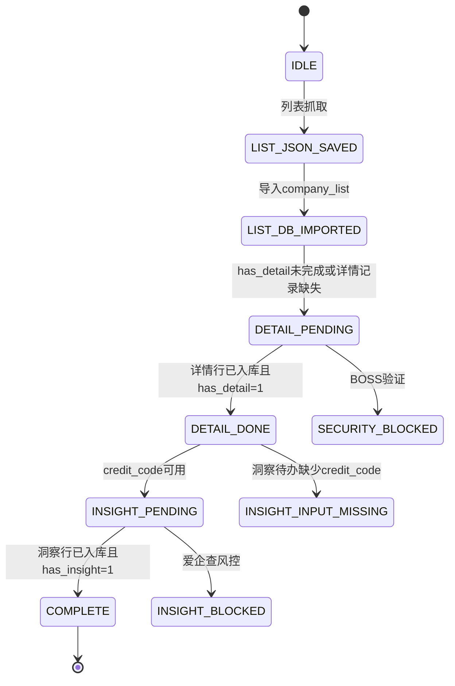

# BOSS直聘 Skill

本 Skill 通过用户本人已经登录的 Chrome 或 Microsoft Edge 的 Chrome DevTools Protocol（CDP）连接 BOSS直聘，抓取个人求职分析所需的公开职位和公司数据。

## 0. Agent 启动协议

本文件是 Skill 的最小启动入口。详细命令、检查工具、状态解释和恢复流程见 [`skill/agent_workflow.md`](skill/agent_workflow.md)。Agent 不需要在启动时读取全部技术参考。

收到任务后按以下顺序执行：

```text
1. 判断用户任务类型。
2. 查询、抓取或恢复任务先执行环境检查。
3. 解析用户 URL，或确认 keyword、city、filters、depth。
4. 生成规范查询 URL 和 query_hash。
5. 执行 --step status，读取 DB 和 JSON 状态。
6. 只执行当前状态对应的现有模块命令。
7. 命令结束后再次执行 --step status。
8. 全部完成才读取结果；遇到登录、风控或数据契约异常就停止。
```

固定状态记录格式：

```text
[check]
当前状态:
事实依据:
查询批次:
已完成:
待完成:
决策点:
下一命令:
停止条件:
```

如果无法回答“当前状态、事实依据、下一命令”，先回到 `CHK-STATUS`，不要猜，不要新建检查脚本。

## 1. 绝对规则

### 1.1 现有入口优先

| 需求 | 唯一优先入口 |
|---|---|
| 检查环境、CDP、登录 | `uv run python -m scripts.boss_cdp_raw --check --cdp-port 9222` |
| 检查真实搜索链路 | `uv run python -m scripts.boss_cdp_raw --smoke-test --cdp-port 9222` |
| 查看批次、待办和 JSON 对账 | `uv run python -m scripts.company_list.pipeline --step status --db-path output/jobs.db` |
| 批量抓 BOSS 公司详情 | `uv run python -u -m scripts.company_list.pipeline --step detail --port 9222 --db-path output/jobs.db`（先补导入当前待办品牌的详情 JSON，再抓剩余项）|
| 批量抓爱企查洞察 | `uv run python -u -m scripts.company_list.pipeline --step insight --port 9222 --db-path output/jobs.db`（抓取后补导入残留 JSON）|
| 执行列表、详情和洞察完整管道 | `uv run python -u -m scripts.company_list.pipeline --step all --keyword "AI Agent" --city 101020100 --db-path output/jobs.db` |
| 导入已有列表 JSON | `uv run python -m scripts.company_list.pipeline --step list --list-json <path> --db-path output/jobs.db` |
| 单条爱企查查询 | `uv run python -u -m scripts.company_insight.scraper <credit_code> --port 9222 --db-path output/jobs.db` |

### 1.2 禁止事项

- 禁止新建 `check_*.py`、`run_*.py`、`verify_*.py`、`inspect_*.py` 等临时脚本。
- 禁止绕过 `scripts/company_list/db.py` 的 `import_*_from_json()` 直接写 SQLite。
- 禁止把 `credit_code` 当作 `brand_id`。
- 禁止把爱企查 `company_id/pageid` 当作项目三表连接键。
- 禁止根据 JSON 文件数量推断 `has_detail` 或 `has_insight`；详情或洞察完成均要求结果表有对应 `brand_id` 记录且列表状态字段为 `1`。
- 禁止把列表导入后的两个 pending 数字直接解释成 detail 和 insight 可以并行。
- 禁止绕过登录验证、验证码和风控，不使用代理轮换、指纹伪造或验证码识别。
- 长任务必须使用 `-u`，让 Agent 能实时读取进度。

## 2. 当前数据契约

```text
company_list.encrypt_brand_id
    = company_detail.brand_id
    = company_insight.brand_id

company_detail.credit_code
    → 爱企查搜索输入

Aiqicha company_id / pageid
    → 爱企查详情页面导航标识
```

当前代码的真实执行链：

```text
列表抓取
  → company_list
  → BOSS 公司详情抓取
  → company_detail.credit_code
  → 爱企查洞察抓取
  → company_insight
```

当前列表映射保存 BOSS 的 `encrypt_brand_id`，没有把统一社会信用代码写入 `company_list`。因此列表导入完成后通常只能启动详情步骤；详情成功并产生 `company_detail.credit_code` 后，才能启动洞察步骤。

最终查询以 `company_list` 为主表：

```sql
FROM company_list AS cl
LEFT JOIN company_detail AS cd
  ON cl.encrypt_brand_id = cd.brand_id
LEFT JOIN company_insight AS ci
  ON cl.encrypt_brand_id = ci.brand_id
```

## 3. 任务路由

### 查询或抓取新任务

先确认：

```text
keyword
city 或 BOSS 查询 URL
filters（可选）
depth：列表、详情、洞察或全部
```

没有 URL 时调用项目方法解析城市并生成查询 URL：

```powershell
uv run python -c "from scripts.boss_cdp_raw import resolve_city; print(resolve_city('上海'))"
uv run python -c "from scripts.company_list.db import build_query_url; print(build_query_url('AI Agent','101020100',{'salary':'405'}))"
uv run python -c "from scripts.company_list.db import compute_query_hash; print(compute_query_hash('QUERY_URL'))"
```

用户只给关键词或城市而没有足够信息时，先补问，不启动抓取。

### 用户提供 BOSS URL

URL 管道将 URL 规范化为批次身份，复用 `--db-path` 指定的数据库，并默认执行列表、详情和洞察完整流程：

```powershell
uv run python -u -m scripts.boss_cdp_raw --url "QUERY_URL" --pages 3 --db-path output/jobs.db --cdp-port 9222
```

显式跳过洞察时使用 `--no-insight`。仅抓列表时同时传入 `--no-detail --no-insight`；跳过的阶段不会被标记为数据库已完成，结果中仍会返回真实待办。

URL 只提供查询条件，不替代 Agent 对抓取深度的判断。

### 继续或恢复任务

先执行：

```powershell
uv run python -m scripts.company_list.pipeline --step status --db-path output/jobs.db
```

根据 `pending_detail`、`pending_insight`、JSON 对账和 `credit_code` 输入完整性选择下一步，不要根据上一次日志猜测。

### 查询已有结果

当两个 pending 都为 0 且数据仍在新鲜度窗口内，停止抓取，使用现有 DB 读取方法和只读联立查询回答用户。

## 4. 状态机摘要



状态含义：

- `IDLE`：没有目标列表 JSON 和 DB 批次。
- `LIST_JSON_SAVED`：列表 JSON 已落盘但尚未导入 `company_list`。
- `LIST_DB_IMPORTED`：列表已入库，通常有 `has_detail=0`。
- `DETAIL_PENDING`：需要访问 BOSS 公司详情页并解析 `credit_code`。
- `DETAIL_DONE`：详情待办为零；只有在详情表记录存在且 `has_detail=1` 时详情才算完成。
- `INSIGHT_PENDING`：使用 `company_detail.credit_code` 查询爱企查。
- `INSIGHT_INPUT_MISSING`：洞察待办缺少 `credit_code`，不能标记为全部完成。
- `COMPLETE`：详情、洞察结果表记录及列表状态标记一致，数据库待办为零。
- `SECURITY_BLOCKED` / `INSIGHT_BLOCKED`：退出码 `2`，必须人工处理后恢复。

完整检查工具和状态分支见 [`skill/agent_workflow.md`](skill/agent_workflow.md)。

## 5. 安装与运行参考

安装参考：完整复制仓库时，至少包括 `skill/agent_workflow.md`、数据库管道模块和摘要入口，例如：

```bash
cp boss-zhipin-scraper/scripts/job_summary.py <skill-dir>/scripts/
```


参数和输出格式见 [`skill/reference.md`](skill/reference.md)。`scripts/job_summary.py` 负责读取已有结果生成聚合分析和求职提示词，不读取本地简历。

Pipeline 技术状态和数据库参考见 [`skill/pipeline.md`](skill/pipeline.md)。

面向用户的完整说明见 [`README.md`](README.md) 和 [`README.en.md`](README.en.md)。

## 6. 版本与开发约束

当前版本为 `2.4.0`。修改版本号时必须同步：

- `scripts/boss_cdp_raw.py`
- `pyproject.toml`
- `SKILL.md`
- `README.md`
- `README.en.md`
- `uv.lock`

本次修复覆盖列表、详情、洞察和 CLI 管道实现；单元测试与语法检查按 `skill/agent_workflow.md` 执行。真实 Edge 抓取验证仍须在合并前按 `AGENTS.md` 完成，本轮不执行真实抓取。
