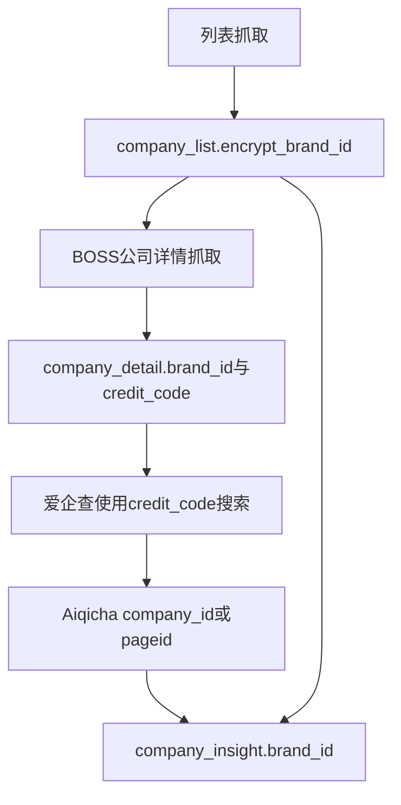
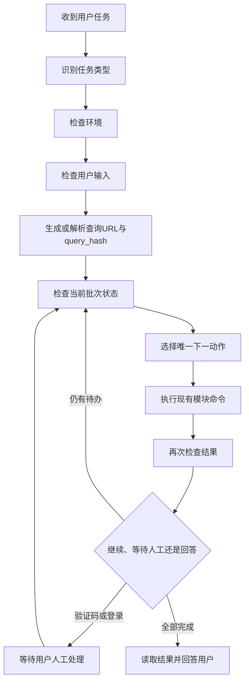

# Agent 工作流与检查工具

> 本文件是 Agent 的执行协议，不是用户教程。
> Agent 遇到 BOSS 职位查询、抓取、恢复、状态检查或结果分析任务时，按本文顺序执行。

## 0. 当前事实契约

当前代码实现的真实数据链路是：



必须区分以下字段：

```text
company_list.encrypt_brand_id
    = company_detail.brand_id
    = company_insight.brand_id

company_detail.credit_code
    → 爱企查搜索输入

Aiqicha company_id / pageid
    → 爱企查详情页面导航标识
```

当前代码中：

- BOSS 列表映射保存 `encrypt_brand_id`，没有把统一社会信用代码写入 `company_list`。
- BOSS 公司详情解析 `business_info`，从中取得 `统一社会信用代码`，写入 `company_detail.credit_code`。
- 爱企查洞察使用 `credit_code` 搜索页面，再将结果以 `brand_id` 写入 `company_insight`。
- 当前执行顺序是 `list → detail → insight`。
- 列表导入后不能直接启动洞察，因为此时通常还没有 `credit_code`。
- 结果表最终可以通过 `brand_id` 回连 `company_list`，但“结果可以连接”不等于“洞察输入已经具备”。

### 错误认知拦截

```text
credit_code 不是 brand_id。
credit_code 不是爱企查 company_id/pageid。
company_list 当前没有 credit_code 列。
company_insight.brand_id 不通过 credit_code 连接 company_list。
列表导入后不能根据 pending 数字宣称 detail 和 insight 可以并发。
```

## 1. Agent 总协议

每个查询或抓取任务严格经过以下阶段：



每次执行前，Agent 输出以下内部状态记录：

```text
[check]
当前状态: <状态名>
事实依据: <命令输出、字段或文件>
查询批次: <query_hash 或 unknown>
已完成: <明确的表、文件和数量>
待完成: <明确的步骤和数量>
决策点: <为什么选择下一动作>
下一命令: <完整的 uv run python -m 命令>
停止条件: <无 / 输入缺失 / 登录 / 风控 / 数据契约异常>
```

如果不能同时说清“当前状态、事实依据、下一命令”，停止业务动作并重新执行 `CHK-STATUS`。

## 2. 检查工具目录

### CHK-ENV：检查 uv、依赖和项目模块

适用情境：Agent 第一次接手项目、依赖报错、模块导入失败。

```powershell
uv run python -c "import requests, websocket; import scripts.boss_cdp_raw, scripts.company_list.pipeline, scripts.company_insight.scraper; print('ENV_OK')"
```

结果解释：

- 输出 `ENV_OK`：允许执行 `CHK-CLI` 或 `CHK-CDP`。
- `ModuleNotFoundError`、`ImportError` 或 uv 环境失败：状态为 `ENV_NOT_READY`。
- `ENV_NOT_READY`：执行 `uv sync`，然后重新执行 `CHK-ENV`。
- 修复依赖前不启动浏览器、不读取业务状态、不写数据库。

允许的修复命令：

```powershell
uv sync
uv run python -c "import requests, websocket; import scripts.boss_cdp_raw, scripts.company_list.pipeline; print('ENV_OK')"
```

### CHK-CLI：检查模块入口和参数

适用情境：命令参数不确定、模块可能未安装、需要确认当前版本支持哪些入口。

```powershell
uv run python -m scripts.boss_cdp_raw --version
uv run python -m scripts.boss_cdp_raw --help
uv run python -m scripts.company_list.pipeline --help
uv run python -m scripts.company_insight.scraper
```

结果解释：

- 能输出版本和帮助：入口存在，按帮助中的参数执行。
- `No module named`：回到 `CHK-ENV`。
- `unrecognized arguments`：读取当前帮助并修正命令，不猜参数、不改成裸脚本路径。
- 单条洞察命令无参数返回用法提示是正常的，不代表环境失败。

项目统一命令形态：

```text
uv run python -m scripts.boss_cdp_raw ...
uv run python -m scripts.company_list.pipeline ...
uv run python -m scripts.company_insight.scraper ...
```

长任务使用 `-u`：

```text
uv run python -u -m scripts.company_list.pipeline --step detail
```

### CHK-CDP：检查 Edge CDP、浏览器和 BOSS 登录态

适用情境：任何需要访问 BOSS 或爱企查页面的任务。

```powershell
uv run python -m scripts.boss_cdp_raw --check --cdp-port 9222
```

`--check` 包含三项检查：

```text
[1/3] Python 依赖
[2/3] CDP 端口连通性
[3/3] BOSS直聘登录状态
```

结果解释：

- 三项通过并输出“所有检查通过”：进入输入解析或状态检查。
- 依赖失败：状态为 `ENV_NOT_READY`，执行 `CHK-ENV`。
- CDP 端口失败：状态为 `BROWSER_NOT_READY`，执行启动命令后重新检查。
- 未登录：状态为 `LOGIN_REQUIRED`，要求用户在 Edge 中人工登录。
- 限制状态、安全校验或访问频繁：状态为 `SECURITY_BLOCKED`，交用户人工处理，不自动绕过、不换 IP、不密集重试。
- `--check` 失败不能解释成“没有职位”。

当前机器使用 Edge：

```powershell
uv run python -m scripts.boss_cdp_raw --setup-edge --cdp-port 9222
```

只启动浏览器，不等待登录：

```powershell
uv run python -m scripts.boss_cdp_raw --setup-edge --cdp-port 9222 --no-wait-login
uv run python -m scripts.boss_cdp_raw --check --cdp-port 9222
```

### CHK-SMOKE：检查真实搜索链路

适用情境：`CHK-CDP` 通过但实际搜索响应异常，或修改了列表/登录链路。

```powershell
uv run python -m scripts.boss_cdp_raw --smoke-test --cdp-port 9222
```

结果解释：

- `Smoke test 通过`：页面自身搜索响应可捕获，并且样例职位包含基本字段；允许执行列表抓取。
- 未捕获页面自身搜索响应：回到 `CHK-CDP`，检查登录、CDP 和风控。
- 未拿到可用职位：不能直接判断为“搜索结果为空”；先检查登录状态、输入城市和页面响应。
- Smoke test 不写结果 JSON，也不代表 DB 已完成。

### CHK-CITY：检查城市输入

适用情境：用户给了中文城市名、城市码不确定或查询 URL 缺少有效城市。

```powershell
uv run python -c "from scripts.boss_cdp_raw import resolve_city; print(resolve_city('上海'))"
```

结果解释：

- 输出 `('上海', '101020100')`：城市有效。
- `CityResolutionError`：状态为 `INPUT_INVALID`，要求用户提供受支持的城市名或 9 位 city_code。
- 不手工猜城市码，不把未解析中文名直接发送给 BOSS。

列出城市：

```powershell
uv run python -m scripts.boss_cdp_raw --list-cities
uv run python -m scripts.boss_cdp_raw --list-cities 上海
```

### CHK-QUERY：生成查询 URL、query_hash 和决策

适用情境：新查询、用户没有提供完整 URL、需要确定当前批次。

生成规范查询 URL：

```powershell
uv run python -c "from scripts.company_list.db import build_query_url; print(build_query_url('AI Agent','101020100',{'salary':'405','degree':'203'}))"
```

生成批次键：

```powershell
uv run python -c "from scripts.company_list.db import compute_query_hash; print(compute_query_hash('QUERY_URL'))"
```

读取 PipelineState：

```powershell
uv run python -c "from scripts.company_list.pipeline import PipelineState; p=PipelineState('QUERY_URL'); print({'query_hash':p.query_hash,'step':p.step,'action':p.decide()}); p.db.close()"
```

结果解释：

- `SCRAPE_LIST`：没有可复用列表 JSON，执行列表抓取。
- `IMPORT_LIST`：已有列表 JSON，执行导入，不重复抓列表。
- `RESUME_REFRESH`：批次过期，通过 URL 管道刷新。
- `SCRAPE_INSIGHT`：只代表状态机认为存在洞察待办；执行前仍要检查 `credit_code` 是否存在。
- `SKIP`：批次在新鲜度窗口内；仍需执行 `CHK-STATUS`，不能只凭 `SKIP` 宣称三张表都完整。

### CHK-STATUS：检查统一业务状态

适用情境：每次准备行动前、长任务结束后、异常中断后、用户询问“现在到哪了”。

```powershell
uv run python -m scripts.company_list.pipeline --step status --db-path output/jobs.db
```

必须读取六个区块：

```text
[1] 查询批次
[2] 总体进度
[3] 待爬详情
[4] 待爬洞察
[5] 洞察 JSON 对账
[6] 最近入库的洞察
```

结果解释：

- 无查询批次且无目标 JSON：`IDLE`，执行列表抓取。
- 列表 JSON 存在但 DB 无对应批次：`LIST_JSON_SAVED`，执行列表导入。
- `pending_detail > 0`：`DETAIL_PENDING`，执行 `--step detail`。
- `pending_detail = 0` 且存在可用洞察待办：`INSIGHT_PENDING`，执行 `--step insight`。
- 两个 pending 都为 0：`COMPLETE`，停止抓取并读取结果。
- 洞察待办缺少 `credit_code`：`INSIGHT_INPUT_MISSING`，不能猜测信用代码。
- JSON 对账存在孤儿、旧命名、重复或无法解析文件：先记录异常，不自行删除或重命名。

注意：当前 `pending_insight` 只统计已经能够通过 `company_detail` 关联的洞察对象。因此列表刚导入时看到 `pending_insight=0`，不代表洞察已经完成，而可能代表 `company_detail` 尚未产生洞察输入。

### CHK-DB：通过现有 JobDatabase 方法检查状态

适用情境：需要确认具体的 `has_detail`、`has_insight`、待办列表、批次摘要。

```powershell
uv run python -c "from scripts.company_list.db import JobDatabase; db=JobDatabase('output/jobs.db'); db.connect(); db.init_schema(); print('stats=',db.get_stats()); print('detail_pending=',db.get_pending_detail_brands()); print('insight_pending=',db.get_pending_insight_brands()); db.close()"
```

指定批次：

```powershell
uv run python -c "from scripts.company_list.db import JobDatabase; db=JobDatabase('output/jobs.db'); db.connect(); db.init_schema(); print(db.get_query_info('QUERY_HASH')); db.close()"
```

结果解释：

- `get_pending_detail_brands()` 非空：存在 `has_detail=0`，执行详情。
- `get_pending_insight_brands()` 非空且包含 `credit_code`：存在可执行的洞察待办。
- 洞察待办为空但 `company_detail` 尚未完成：先执行详情。
- 洞察待办存在但缺 `credit_code`：状态为 `INSIGHT_INPUT_MISSING`，停止猜测。
- `get_query_info()` 返回 `None`：该 query_hash 未入库，检查 JSON 再决定抓取或导入。

### CHK-LINK：检查三张表的真实连接键

适用情境：Agent 怀疑表关系、结果查询为空或准备核对数据契约。

```powershell
uv run python -c "import sqlite3; c=sqlite3.connect('output/jobs.db'); cols={r[1] for r in c.execute('PRAGMA table_info(company_list)')}; print('required_link_columns=',{'encrypt_brand_id','has_detail','has_insight'} <= cols); print('detail_linked=',c.execute('SELECT COUNT(*) FROM company_list cl JOIN company_detail cd ON cl.encrypt_brand_id=cd.brand_id WHERE cl.encrypt_brand_id IS NOT NULL').fetchone()[0]); print('insight_linked=',c.execute('SELECT COUNT(*) FROM company_list cl JOIN company_insight ci ON cl.encrypt_brand_id=ci.brand_id WHERE cl.encrypt_brand_id IS NOT NULL').fetchone()[0]); c.close()"
```

正确连接关系：

```text
company_list.encrypt_brand_id = company_detail.brand_id
company_list.encrypt_brand_id = company_insight.brand_id
```

结果解释：

- `required_link_columns=True`：列表表具备连接和状态字段。
- 连接计数为 0 不一定是错误，可能是对应结果表尚未写入；结合 pending 状态判断。
- 连接键不一致：状态为 `DATA_CONTRACT_BROKEN`，停止修改数据，不手工改 `brand_id`。
- 不允许使用 `credit_code` 替代 `brand_id` 做三表连接。

### CHK-JSON：检查文件和 JSON 语法

适用情境：步骤日志显示成功但 DB 状态未变化，或 status 报告 JSON/DB 不一致。

```powershell
Test-Path "output/query/QUERY_HASH.json"
Test-Path "output/company/BRAND_ID.json"
Test-Path "output/insight/aqc_CREDIT_CODE.json"
uv run python -m json.tool "output/query/QUERY_HASH.json" *> $null; if ($LASTEXITCODE -eq 0) { 'JSON_OK' } else { 'JSON_INVALID' }
```

结果解释：

- JSON 存在且可解析、DB 未完成：使用现有 `--step` 补导入，不重抓。
- JSON 不存在：回到 `CHK-STATUS`，不能仅凭文件判断 DB 状态。
- `JSON_INVALID`：保留错误信息，不直接删除，不新写修复脚本。
- 洞察规范命名是 `aqc_{credit_code}.json`；命名异常由 status 对账区块报告。

### CHK-CODE：代码变更检查

适用情境：只有修改 Python 代码时使用。本次文档任务不修改业务代码。

```powershell
uv run python -m py_compile scripts/boss_cdp_raw.py scripts/company_list/db.py scripts/company_list/pipeline.py scripts/company_detail/extractor.py scripts/company_insight/scraper.py
uv run python -m unittest tests.chrome_setup.test_chrome_setup
uv run python -m unittest tests.company_list.test_db
uv run python -m unittest tests.company_detail.test_extractor
```

测试通过不能证明真实浏览器抓取成功；真实链路仍需 `CHK-CDP` 和 `CHK-SMOKE`。

## 3. 状态到唯一动作

### `IDLE` / `SCRAPE_LIST`

```powershell
uv run python -u -m scripts.boss_cdp_raw --db --step list --keyword "AI Agent" --city 101020100 --pages 3 --cdp-port 9222
```

结果：生成 `output/query/{query_hash}.json` 并导入 `company_list`。之后执行 `CHK-STATUS`，通常进入 `DETAIL_PENDING`。

### `LIST_JSON_SAVED` / `IMPORT_LIST`

```powershell
uv run python -m scripts.company_list.pipeline --step list --list-json "output/query/QUERY_HASH.json" --db-path output/jobs.db
```

结果：列表 JSON 导入 `company_list`，不重新抓列表。

### `DETAIL_PENDING`

```powershell
uv run python -u -m scripts.company_list.pipeline --step detail --port 9222 --db-path output/jobs.db
```

内部关系：

```text
company_list.has_detail=0
→ company_link
→ BOSS 公司详情页
→ business_info.统一社会信用代码
→ company_detail.brand_id / company_detail.credit_code
→ company_list.has_detail=1
```

详情完成后必须重新执行 `CHK-STATUS`，确认洞察输入是否已经产生。

### `INSIGHT_PENDING`

```powershell
uv run python -u -m scripts.company_list.pipeline --step insight --port 9222 --insight-delay 15 --db-path output/jobs.db
```

内部关系：

```text
company_detail.credit_code
→ 爱企查搜索页
→ 爱企查 company_id/pageid
→ 爱企查详情页
→ company_insight.brand_id
→ company_list.has_insight=1
```

### `COMPLETE`

当 `pending_detail=0` 且 `pending_insight=0` 时，停止抓取，使用三表只读查询回答用户。

推荐连接形态：

```sql
SELECT cl.query_hash,
       cl.job_id, cl.title, cl.salary, cl.location,
       cl.encrypt_brand_id, cl.has_detail, cl.has_insight,
       cd.company_name AS detail_company_name,
       cd.description AS detail_description,
       ci.company_name AS insight_company_name,
       ci.legal_person, ci.business_status
FROM company_list AS cl
LEFT JOIN company_detail AS cd
  ON cl.encrypt_brand_id = cd.brand_id
LEFT JOIN company_insight AS ci
  ON cl.encrypt_brand_id = ci.brand_id
WHERE cl.query_hash = 'QUERY_HASH';
```

## 4. 异常和停止协议

### `LOGIN_REQUIRED`

停止抓取，让用户在 Edge 中登录；用户完成后重新执行 `CHK-CDP`。

### `SECURITY_BLOCKED`

程序退出码为 `2` 时，按提示 URL 由用户人工完成验证。禁止自动绕过、验证码识别、换 IP 和盲目重试。完成后重跑原命令，再执行 `CHK-STATUS`。

### `INSIGHT_INPUT_MISSING`

说明当前洞察待办没有可用 `credit_code`。先执行详情步骤；如果详情已完成仍缺失，报告数据不完整，不通过 `brand_id` 猜测信用代码。

### `DATA_CONTRACT_BROKEN`

说明三表连接键或字段契约异常。停止业务动作，报告具体表、字段和连接结果。禁止手工修改数据库、复制 JSON 或创建临时检查脚本。

### `ERROR`

```text
1. 保存完整命令和错误输出。
2. 执行 CHK-STATUS，确认是否已有部分进度。
3. 使用 CHK-JSON、CHK-DB 或 CHK-LINK 缩小问题范围。
4. 只使用现有模块入口恢复。
5. 无法判断时报告问题，不自行写 check_*.py、run_*.py 或 inspect_*.py。
```

## 5. 绝对禁止

- 禁止把 `credit_code` 当作 `brand_id`。
- 禁止把爱企查 `company_id/pageid` 当作项目数据库连接键。
- 禁止根据“两个 pending 都有数字”宣称可以并发；当前洞察输入依赖详情产生的 `credit_code`。
- 禁止新建临时 `check_*.py`、`run_*.py`、`inspect_*.py` 脚本。
- 禁止绕过 `JobDatabase` 的导入方法直接写 SQLite。
- 禁止用 JSON 文件数量代替 `has_detail`、`has_insight` 状态。
- 禁止将登录、风控和空结果混为同一种失败。
- 禁止绕过验证码或通过代理、指纹伪造等手段规避风控。
