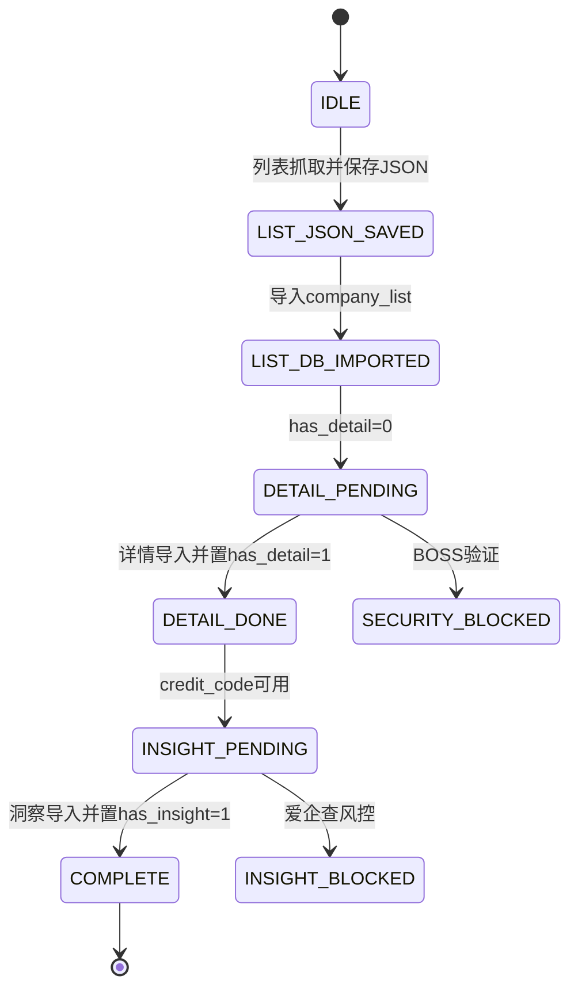
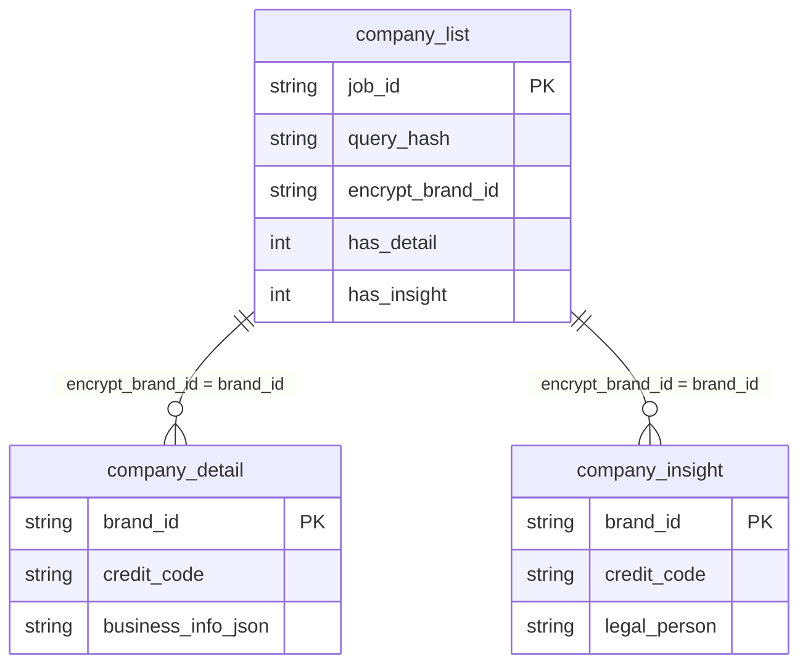

# Pipeline 技术参考

> 本文件只描述当前实现的 Pipeline、数据库契约和恢复语义。Agent 的执行顺序、检查工具和精确命令见 [`agent_workflow.md`](agent_workflow.md)。

## 当前实现契约

当前代码没有把统一社会信用代码从 BOSS 列表写入 `company_list`。列表阶段得到的是 BOSS 公司键 `encrypt_brand_id`；详情阶段访问 BOSS 公司页并解析 `business_info`，之后才产生 `company_detail.credit_code`。

```text
list
  → company_list.encrypt_brand_id
  → detail
  → company_detail.brand_id + company_detail.credit_code
  → insight 使用 credit_code 查询爱企查
  → company_insight.brand_id 回连 company_list.encrypt_brand_id
```

字段不能混用：

```text
company_list.encrypt_brand_id = company_detail.brand_id
company_list.encrypt_brand_id = company_insight.brand_id
company_detail.credit_code    → 爱企查搜索输入
Aiqicha company_id/pageid     → 爱企查页面导航标识
```

## 状态机



状态含义：

- `IDLE`：没有对应的列表 JSON 和数据库批次。
- `LIST_JSON_SAVED`：列表 JSON 已落盘，但尚未导入 `company_list`。
- `LIST_DB_IMPORTED`：列表已进入 `company_list`，通常存在 `has_detail=0`。
- `DETAIL_PENDING`：需要通过 `company_link` 抓取 BOSS 公司详情。
- `DETAIL_DONE`：详情已入库，且产生了可供洞察使用的 `credit_code`。
- `INSIGHT_PENDING`：使用 `credit_code` 查询爱企查并写入洞察表。
- `COMPLETE`：详情和洞察待办都完成。
- `SECURITY_BLOCKED`：BOSS 验证码或安全校验，退出码 `2`。
- `INSIGHT_BLOCKED`：爱企查验证码或风控，退出码 `2`。

## `PipelineState.decide()`

| 条件 | 返回值 | 处理 |
|---|---|---|
| DB 有数据且在新鲜度窗口内，没有可执行洞察待办 | `SKIP` | 执行只读结果查询，但仍核对 status |
| DB 有数据且在新鲜度窗口内，有洞察待办 | `SCRAPE_INSIGHT` | 先确认待办包含 `credit_code`，再执行洞察 |
| DB 有数据但已过期 | `RESUME_REFRESH` | 通过 URL 管道刷新当前批次 |
| 无 DB 数据但列表 JSON 存在 | `IMPORT_LIST` | 导入列表 JSON，不重复抓取 |
| 没有 DB 数据和列表 JSON | `SCRAPE_LIST` | 从列表抓取开始 |

`decide()` 只返回一个下一步动作，不能代替完整状态检查。尤其是列表刚导入时，`insight_pending` 可能还没有统计到对象，因为洞察查询依赖 `company_detail`。Agent 必须以 `has_detail`、`has_insight` 和待办输入完整性共同判断。

## 管道步骤

| 步骤 | 输入 | 输出 | 状态变化 |
|---|---|---|---|
| step1 列表抓取 | keyword、city、filters | `output/query/{query_hash}.json` | 形成列表 JSON |
| step2 列表导入 | 列表 JSON | `company_list` | 新行 `has_detail=0`、`has_insight=0` |
| step3 详情抓取 | `company_list.company_link` | `output/company/{brand_id}.json` | 解析 BOSS 工商信息 |
| step4 详情导入 | 详情 JSON | `company_detail` | 更新 `has_detail=1`，产生 `credit_code` |
| step5 洞察抓取 | `company_detail.credit_code` | `output/insight/aqc_{credit_code}.json` | 查询爱企查 |
| step6 洞察导入 | 洞察 JSON + brand_id | `company_insight` | 更新 `has_insight=1` |

当前执行顺序为：

```text
step1 → step2 → step3 → step4 → step5 → step6
```

不要把 `step3/4` 与 `step5/6` 描述为列表导入后即可并行。详情和洞察最终写不同的结果表，但洞察的 `credit_code` 输入由详情阶段产生。

## 数据表关系



三张表的业务连接键：

```text
company_list.encrypt_brand_id = company_detail.brand_id
company_list.encrypt_brand_id = company_insight.brand_id
```

不是：

```text
company_list.credit_code
company_detail.credit_code = company_insight.brand_id
company_detail.credit_code = Aiqicha company_id
```

`credit_code` 可以同时作为 `company_detail` 和 `company_insight` 的业务字段，但不替代三表的 `brand_id` 连接。

## 中断恢复

| 场景 | 检查结果 | 恢复动作 |
|---|---|---|
| 首次查询 | 没有 JSON 和 DB 批次 | 执行列表抓取 |
| JSON 已保存未入库 | 文件存在，query_hash 无 DB 记录 | 执行 `--step list --list-json` |
| 列表已入库 | `pending_detail > 0` | 执行 `--step detail` |
| 详情完成 | `pending_detail=0`，洞察待办有 `credit_code` | 执行 `--step insight` |
| 洞察 JSON 已保存未入库 | 文件存在，`has_insight=0` | 使用 step5/step6 补导入，不重抓 |
| 全部完成 | 两个 pending 都为 0 | 只读查询 |
| BOSS 风控 | `SecurityCheckError`，退出码 2 | 人工处理后重跑原命令 |
| 爱企查风控 | `InsightBlockedError`，退出码 2 | 人工处理后重跑洞察命令 |

## 文件路径

| 用途 | 路径 |
|---|---|
| SQLite | `output/jobs.db` |
| 列表 JSON | `output/query/{query_hash}.json` |
| BOSS 公司详情 JSON | `output/company/{brand_id}.json` |
| 爱企查洞察 JSON | `output/insight/aqc_{credit_code}.json` |

## 查询示例

以列表表为主表，同时读取 BOSS 公司详情和爱企查洞察：

```sql
SELECT cl.query_hash,
       cl.job_id,
       cl.title,
       cl.salary,
       cl.location,
       cl.encrypt_brand_id,
       cl.has_detail,
       cl.has_insight,
       cd.company_name AS detail_company_name,
       cd.credit_code AS aqc_search_input,
       cd.description AS detail_description,
       ci.company_name AS insight_company_name,
       ci.legal_person,
       ci.business_status
FROM company_list AS cl
LEFT JOIN company_detail AS cd
  ON cl.encrypt_brand_id = cd.brand_id
LEFT JOIN company_insight AS ci
  ON cl.encrypt_brand_id = ci.brand_id
WHERE cl.query_hash = 'QUERY_HASH';
```

爱企查搜索进度不能通过 `company_list.credit_code` 查询，因为当前列表表没有该字段。应读取 `company_detail.credit_code` 或 `company_insight.credit_code`。
