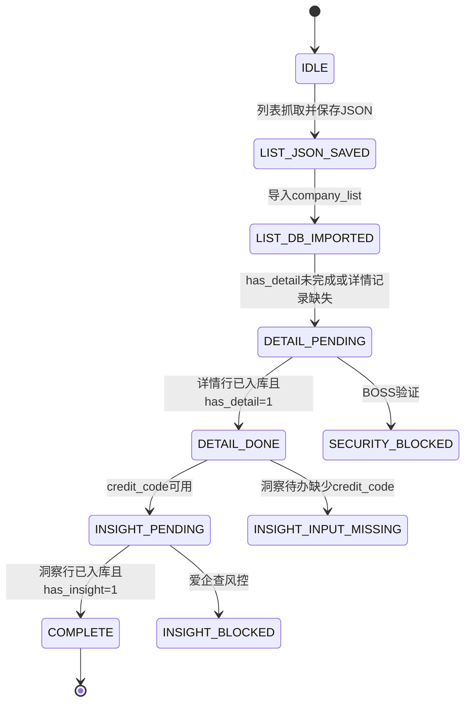
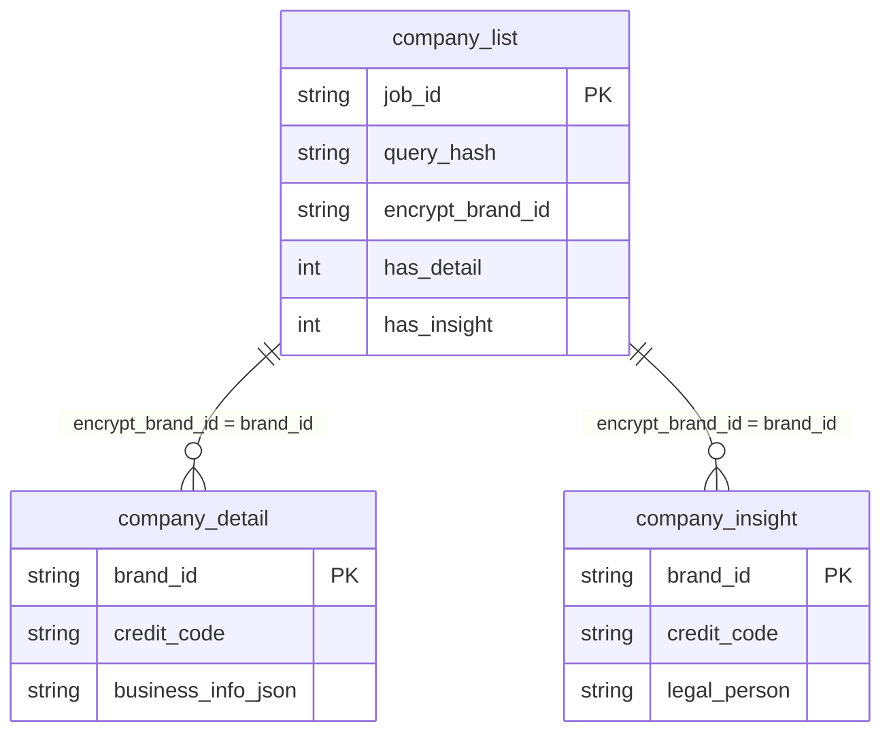

# Pipeline 技术参考

> 本文件只描述当前实现的 Pipeline、数据库契约和恢复语义。Agent 的执行顺序、检查工具和精确命令见 [`agent_workflow.md`](agent_workflow.md)。

## 当前实现契约

当前代码没有把统一社会信用代码从 BOSS 列表写入 `company_list`。列表阶段得到的是 BOSS 公司键 `encrypt_brand_id`；详情阶段访问 BOSS 公司页并解析 `business_info`，之后才产生 `company_detail.credit_code`。

```text
list
  → company_list.encrypt_brand_id
  → detail
  → company_detail.brand_id + company_detail.credit_code
  → insight 使用 credit_code 查询爱企查
  → company_insight.brand_id 回连 company_list.encrypt_brand_id
```

字段不能混用：

```text
company_list.encrypt_brand_id = company_detail.brand_id
company_list.encrypt_brand_id = company_insight.brand_id
company_detail.credit_code    → 爱企查搜索输入
Aiqicha company_id/pageid     → 爱企查页面导航标识
```

## 状态机



状态含义：

- `IDLE`：没有对应的列表 JSON 和数据库批次。
- `LIST_JSON_SAVED`：列表 JSON 已落盘，但尚未导入 `company_list`。
- `LIST_DB_IMPORTED`：列表已进入 `company_list`，仍有详情待办，或详情结果记录缺失。
- `DETAIL_PENDING`：需要通过 `company_link` 抓取 BOSS 公司详情。
- `DETAIL_DONE`：本批次详情待办为零；若洞察仍待处理，继续检查 `credit_code`。
- `INSIGHT_PENDING`：使用 `credit_code` 查询爱企查并写入洞察表。
- `INSIGHT_INPUT_MISSING`：洞察待办缺少 `credit_code`，需先核对详情结果，不能当作完成。
- `COMPLETE`：详情与洞察均满足“结果表有对应 `brand_id` 记录且 `company_list` 状态字段为 1”，数据库待办数为零。
- `SECURITY_BLOCKED`：BOSS 验证码或安全校验，退出码 `2`。
- `INSIGHT_BLOCKED`：爱企查验证码或风控，退出码 `2`。

## `PipelineState.decide()`

| 条件 | 返回值 | 处理 |
|---|---|---|
| 当前 query_hash 无 DB 批次，且规范列表 JSON 存在 | `IMPORT_LIST` | 导入列表 JSON，不重复抓取 |
| 当前 query_hash 无 DB 批次，列表 JSON 不存在 | `SCRAPE_LIST` | 从列表抓取开始 |
| DB 有详情待办或缺少详情结果记录 | `RESUME_DETAIL` | 优先补导入当前待办品牌的详情 JSON，再抓剩余详情；不被新鲜度跳过 |
| 详情待办为 0，洞察待办含可用 `credit_code` | `SCRAPE_INSIGHT` | 补导入已有洞察 JSON，再处理剩余洞察 |
| 详情待办为 0，洞察待办缺少 `credit_code` | `INSIGHT_INPUT_MISSING` | 报告阻塞输入，不能返回 `SKIP` 或 `COMPLETE` |
| 详情和洞察待办均为 0，数据仍新鲜 | `SKIP` | 使用只读查询读取结果 |
| 详情和洞察待办均为 0，数据已过期 | `RESUME_REFRESH` | 刷新当前列表批次 |

`decide()` 优先检查详情待办，其次检查洞察待办与输入完整性，最后才判断新鲜度。结果表记录与状态标记均满足后，数据库待办才会归零。用户选择跳过的阶段通过 `skipped_steps` 单独返回，不会改写数据库状态。

## 管道步骤

| 步骤 | 输入 | 输出 | 状态变化 |
|---|---|---|---|
| step1 列表抓取 | keyword、city、filters | `output/query/{query_hash}.json` | 形成列表 JSON |
| step2 列表导入 | 列表 JSON | `company_list` | 新行 `has_detail=0`、`has_insight=0` |
| step3 详情抓取 | `company_list.company_link` | `output/company/{brand_id}.json` | 解析 BOSS 工商信息 |
| step4 详情导入 | 详情 JSON | `company_detail` | 更新 `has_detail=1`，产生 `credit_code` |
| step5 洞察抓取 | `company_detail.credit_code` | `output/insight/aqc_{credit_code}.json` | 查询爱企查 |
| step6 洞察导入 | 洞察 JSON + brand_id | `company_insight` | 更新 `has_insight=1` |

当前执行顺序为：

```text
step1 → step2 → step3 → step4 → step5 → step6
```

详情阶段先按 `get_pending_detail_brands()` 为当前数据库待办补导入 `output/company/{brand_id}.json`，再抓剩余品牌；每家抓完立即导入并更新 `has_detail`。step4 兜底只处理当前待办或显式传入的 `(json_path, brand_id)`，不会扫描并导入目录中的无关公司文件。

洞察阶段先复用规范路径 `aqc_{credit_code}.json`，再抓取剩余待办；step6 补导入旧命名残留文件。损坏 JSON、无法反查 `brand_id` 和已完成品牌分别记录或跳过，不阻断其他文件。`--step insight` 与完整管道都执行 step5、step6。

JSON 文件存在不表示步骤完成。详情验收要求 `company_detail` 有 `brand_id` 记录且 `company_list.has_detail=1`；洞察验收要求 `company_insight` 有 `brand_id` 记录且 `company_list.has_insight=1`。阶段结果必须重新从 DB 读取。

不要把 `step3/4` 与 `step5/6` 描述为列表导入后即可并行。详情和洞察最终写不同的结果表，但洞察的 `credit_code` 输入由详情阶段产生。

## 统一入口

- `python -m scripts.company_list.pipeline --step detail`：补导入当前待办公司的详情 JSON，再抓取未完成详情。
- `python -m scripts.company_list.pipeline --step insight`：执行洞察补导入、剩余抓取和残留 JSON 导入；通过 `--db-path` 选择数据库。
- `python -m scripts.company_list.pipeline --step all`：执行列表、详情和洞察；需要 `--keyword` 与 `--city`，或通过 `--list-json` 提供列表输入。参数不足会在连接数据库或抓取前报错。
- `python -m scripts.boss_cdp_raw --url QUERY_URL`：调用相同的 `PipelineState` 编排，默认执行完整三阶段并使用 `--db-path` 指定的数据库；`--no-insight` 显式跳过洞察。
- 独立 `scripts.company_detail.extractor` 只抓取并保存 JSON，不更新 SQLite 的 `has_detail`。
- 单条 `scripts.company_insight.scraper` 先尝试导入现有 JSON；抓取后若未能入库，退出码为 `1`。验证码/风控仍以退出码 `2` 交人工处理。

## 数据表关系



三张表的业务连接键：

```text
company_list.encrypt_brand_id = company_detail.brand_id
company_list.encrypt_brand_id = company_insight.brand_id
```

不是：

```text
company_list.credit_code
company_detail.credit_code = company_insight.brand_id
company_detail.credit_code = Aiqicha company_id
```

`credit_code` 可以同时作为 `company_detail` 和 `company_insight` 的业务字段，但不替代三表的 `brand_id` 连接。

## 中断恢复

| 场景 | 检查结果 | 恢复动作 |
|---|---|---|
| 首次查询 | 没有 JSON 和 DB 批次 | 执行列表抓取 |
| JSON 已保存未入库 | 文件存在，query_hash 无 DB 记录 | 执行 `--step list --list-json` |
| 列表已入库 | 详情待办大于 0（状态未完成或详情记录缺失） | 执行 `--step detail`，先补导入已有详情 JSON |
| 详情完成 | 详情待办为 0，洞察待办存在可用 `credit_code` | 执行 `--step insight` |
| 洞察输入缺失 | 详情待办为 0，但洞察待办无 `credit_code` | 停止洞察，检查详情结果，报告未完成 |
| 洞察 JSON 已保存未入库 | 规范 JSON 存在，`has_insight` 或洞察行未完成 | 先尝试补导入，避免重复抓取 |
| 全部完成 | 两个 pending 都为 0，结果表记录和列表状态字段一致 | 只读查询 |
| BOSS 风控 | `SecurityCheckError`，退出码 2 | 人工处理后重跑原命令 |
| 爱企查风控 | `InsightBlockedError`，退出码 2 | 人工处理后重跑洞察命令 |

## 文件路径

| 用途 | 路径 |
|---|---|
| SQLite | `output/jobs.db` |
| 列表 JSON | `output/query/{query_hash}.json` |
| BOSS 公司详情 JSON | `output/company/{brand_id}.json` |
| 爱企查洞察 JSON | `output/insight/aqc_{credit_code}.json` |

## 查询示例

以列表表为主表，同时读取 BOSS 公司详情和爱企查洞察：

```sql
SELECT cl.query_hash,
       cl.job_id,
       cl.title,
       cl.salary,
       cl.location,
       cl.encrypt_brand_id,
       cl.has_detail,
       cl.has_insight,
       cd.company_name AS detail_company_name,
       cd.credit_code AS aqc_search_input,
       cd.description AS detail_description,
       ci.company_name AS insight_company_name,
       ci.legal_person,
       ci.business_status
FROM company_list AS cl
LEFT JOIN company_detail AS cd
  ON cl.encrypt_brand_id = cd.brand_id
LEFT JOIN company_insight AS ci
  ON cl.encrypt_brand_id = ci.brand_id
WHERE cl.query_hash = 'QUERY_HASH';
```

爱企查搜索进度不能通过 `company_list.credit_code` 查询，因为当前列表表没有该字段。应读取 `company_detail.credit_code` 或 `company_insight.credit_code`。
