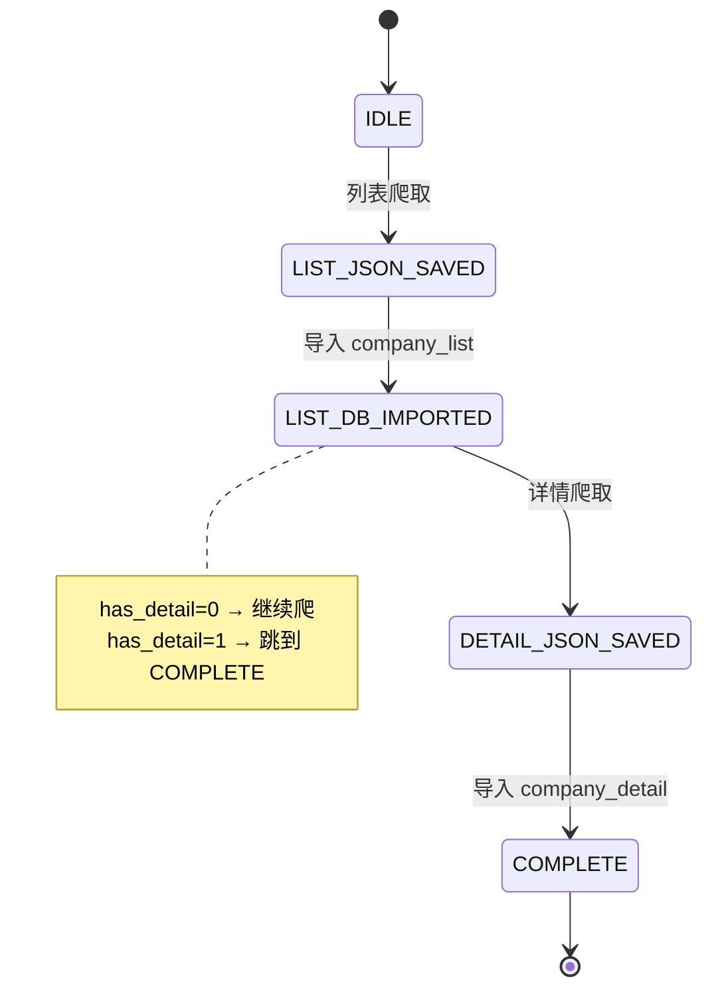
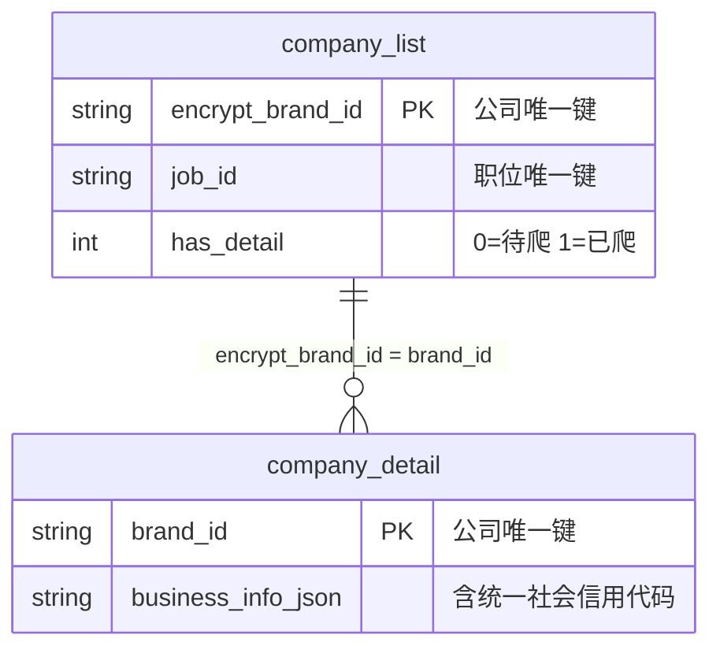

# Pipeline 技术参考

> **Agent 询问流程** 见 SKILL.md 主线 A。本文件只描述 PipelineState 技术实现。

## 状态机

## decide() 决策表

| 条件 | 返回值 | 含义 |
|------|--------|------|
| DB 有数据且 < 24h | `SKIP` | 数据有效，直接查 DB |
| DB 有数据但 ≥ 24h | `RESUME_REFRESH` | 过期，删旧数据后重新跑 |
| 无 DB 数据，JSON 存在 | `IMPORT_LIST` | 跳过爬取，直接导入 DB |
| 什么都没有 | `SCRAPE_LIST` | 从头执行完整管线 |

新鲜度通过环境变量 `BOSS_QUERY_FRESHNESS_HOURS` 配置（默认 24）。

## 中断恢复场景

| 场景 | decide() 返回 | run() 行为 |
|------|--------------|-----------|
| 首次查询 | `SCRAPE_LIST` | 完整执行 step1→step2→step3→step4 |
| JSON 已爬未导入 | `IMPORT_LIST` | 跳过 step1，从 step2 开始 |
| 列表在 DB，详情未爬完 | (step=LIST_DB_IMPORTED) | 跳过 step1-2，从 step3 开始 |
| 全部完成，未过期 | `SKIP` | 不调 run()，直接查 DB |
| 全部完成，已过期 | `RESUME_REFRESH` | 删旧数据后从头 run() |

## 管道步骤

| 步骤 | 输入 | 输出 | 幂等性 |
|------|------|------|--------|
| step1 scrape_list | keyword, city, filters | `output/query/{query_hash}.json` | 覆盖写入 |
| step2 import_list | JSON 文件 | `company_list` 表行 | INSERT OR IGNORE |
| step3 scrape_details | DB 中 has_detail=0 的 brand | `output/company/{brand_id}.json` | 覆盖写入 |
| step4 import_details | JSON 文件 | `company_detail` 表 + has_detail=1 | INSERT OR REPLACE |

## 表关系与联立键

**联立键**：`company_list.encrypt_brand_id` = `company_detail.brand_id`

## 文件路径

| 用途 | 路径 | 说明 |
|------|------|------|
| SQLite 数据库 | `output/jobs.db` | 三表桥接存储 |
| 列表 JSON 归档 | `output/query/{query_hash}.json` | 每次搜索一份 |
| 详情 JSON 归档 | `output/company/{brand_id}.json` | 每家公司一份 |

路径相对于项目根目录，可用 `--db-path` 自定义 DB 位置。output/ 不参与版本管理。
