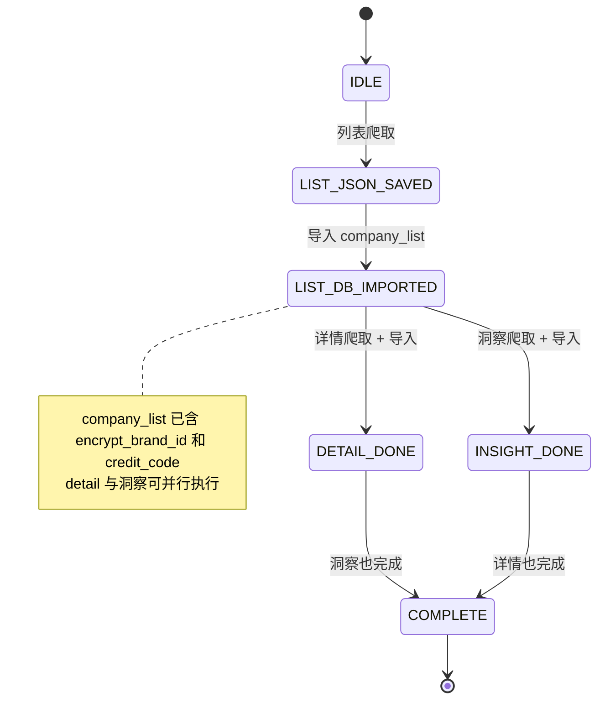
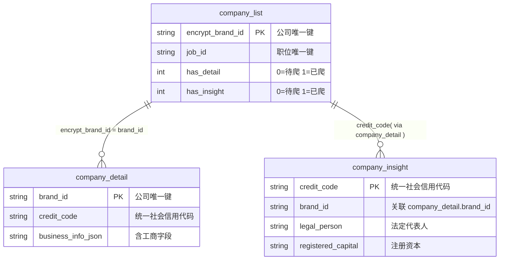

# Pipeline 技术参考

> **Agent 询问流程** 见 SKILL.md 主线 A。本文件只描述 PipelineState 技术实现。

## 状态机

> **并行执行**：step2 完成后 `company_list` 已含 `encrypt_brand_id`（详情联立键）和 `credit_code`（洞察联立键），两条路径无依赖。agent 可开两个子线程分别执行 `--step detail` 和 `--step insight`，各自独立写各自的表。`run_full_pipeline()` 串行调用是简化入口，生产用法推荐并行。

## decide() 决策表

| 条件 | 返回值 | 含义 |
|------|--------|------|
| DB 有数据且 < 24h，无待洞察 | `SKIP` | 数据有效，直接查 DB |
| DB 有数据且 < 24h，有待洞察 | `SCRAPE_INSIGHT` | 跳过 step1-4，直接执行 step5-6 |
| DB 有数据但 ≥ 24h | `RESUME_REFRESH` | 过期，删旧数据后重新跑 |
| 无 DB 数据，JSON 存在 | `IMPORT_LIST` | 跳过爬取，直接导入 DB |
| 什么都没有 | `SCRAPE_LIST` | 从头执行完整管线 |

新鲜度通过环境变量 `BOSS_QUERY_FRESHNESS_HOURS` 配置（默认 24）。

## 中断恢复场景

| 场景 | decide() 返回 | run() 行为 |
|------|--------------|-----------|
| 首次查询 | `SCRAPE_LIST` | 完整执行 step1→step2→step3→step4→step5→step6 |
| JSON 已爬未导入 | `IMPORT_LIST` | 跳过 step1，从 step2 开始 |
| 列表在 DB，详情未爬完 | (step=LIST_DB_IMPORTED) | 跳过 step1-2，从 step3 开始 |
| 详情完成，洞察待爬 | `SCRAPE_INSIGHT` | 跳过 step1-4，从 step5 开始 |
| 全部完成，未过期 | `SKIP` | 不调 run()，直接查 DB |
| 全部完成，已过期 | `RESUME_REFRESH` | 删旧数据后从头 run() |

## 管道步骤

| 步骤 | 输入 | 输出 | 幂等性 | 并行 |
|------|------|------|--------|------|
| step1 scrape_list | keyword, city, filters | `output/query/{query_hash}.json` | 覆盖写入 | — |
| step2 import_list | JSON 文件 | `company_list` 表行 | INSERT OR IGNORE | — |
| step3 scrape_details | DB 中 has_detail=0 的 brand | `output/company/{brand_id}.json` | 覆盖写入 | ↕ 与 step5 并行 |
| step4 import_details | JSON 文件 | `company_detail` 表 + has_detail=1 | INSERT OR REPLACE | ↕ 与 step5 并行 |
| step5 scrape_insights | DB 中 has_insight=0 的公司 | `output/insight/aqc_{credit_code}.json` | 覆盖写入 | ↕ 与 step3-4 并行 |
| step6 import_insights | JSON 文件 | `company_insight` 表 + has_insight=1 | INSERT OR REPLACE | 跟随 step5 |

**step5 洞察脚本说明**：
- 入口函数：`scrape_aqc_by_credit_code(credit_code, cdp_port)`
- CLI 用法：`python -m scripts.company_insight.scraper <credit_code> [--port 9222]`
- 数据来源：`company_list` JOIN `company_detail` 取 `credit_code`
- 工作方式：CDP 导航爱企查详情页 → 解析工商字段 → 结构化输出 → 入库

**独立查询**：用户可直接对任意统一社会信用代码执行 `python -m scripts.company_insight.scraper <credit_code>` 做单条爱企查查询，无需先跑完整管道。输出保存到 `output/insight/{credit_code}.json`。

**step6 兜底导入**：扫描 `output/insight/aqc_*.json`，通过 `credit_code` 反查 `brand_id`，确保中断恢复后不遗漏已抓取的 JSON。

## 表关系与联立键

**联立键**：
- `company_list.encrypt_brand_id` = `company_detail.brand_id`（列表↔详情）
- `company_detail.credit_code` = `company_insight.credit_code`（详情↔洞察）

## 文件路径

| 用途 | 路径 | 说明 |
|------|------|------|
| SQLite 数据库 | `output/jobs.db` | 三表桥接存储 |
| 列表 JSON 归档 | `output/query/{query_hash}.json` | 每次搜索一份 |
| 详情 JSON 归档 | `output/company/{brand_id}.json` | 每家公司一份 |
| 洞察 JSON 归档 | `output/insight/aqc_{credit_code}.json` | 每家公司一份 |

路径相对于项目根目录，可用 `--db-path` 自定义 DB 位置。output/ 不参与版本管理。
