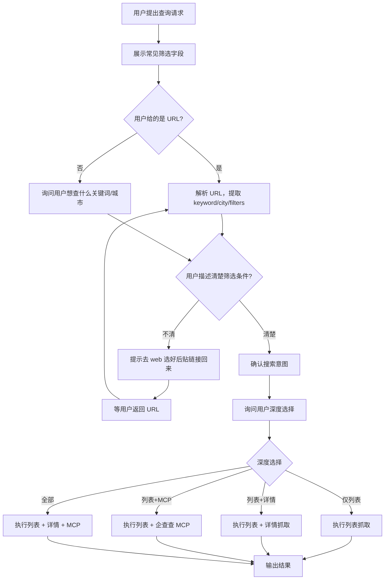
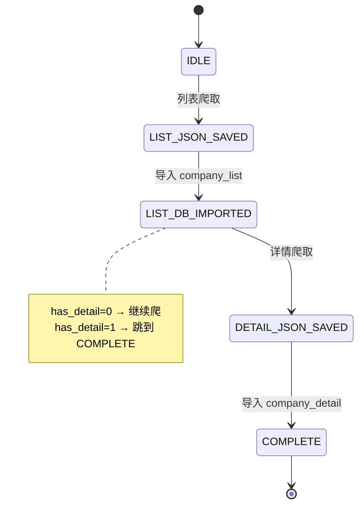
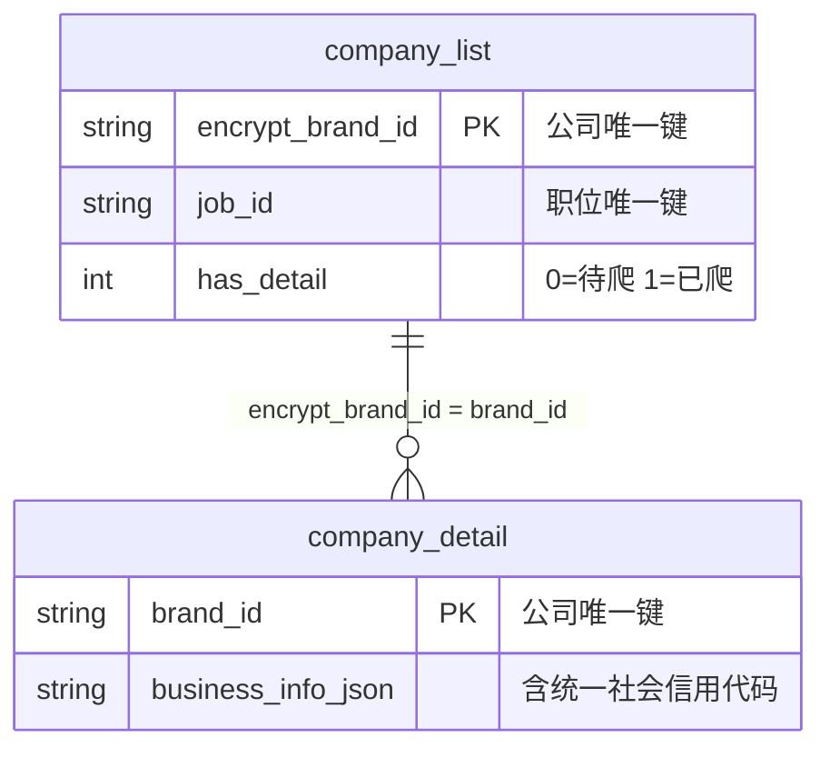

# 管道工作流 (Pipeline)

当用户提出查询 BOSS 职位的需求时，**不要立即执行**。按本章的渐进式询问流程确认需求，再按用户选择执行对应步骤。

## 渐进式询问流程

agent 接到用户查询请求后的工作流：



### 第一步：展示筛选条件，询问过滤

**先向用户展示常见的搜索筛选字段**，让用户知道可以按什么维度过滤：

| 维度 | 常见选项 |
|------|----------|
| 薪资 | 3K以下 / 3-5K / 5-10K / 10-20K / 20-50K / 50K+ |
| 经验 | 在校生 / 应届生 / 1-3年 / 3-5年 / 5-10年 / 10年+ |
| 规模 | 0-20人 / 20-99人 / 100-499人 / 500-999人 / 1000-9999人 / 10000+ |
| 学历 | 大专 / 本科 / 硕士 / 博士 |
| 城市 | 北京 / 上海 / 广州 / 深圳 / 杭州 / 成都 / 武汉 / 南京 |

然后询问用户需要哪些过滤条件。如果用户描述不清具体筛选，**建议去 web 端选择后贴链接**：

> "你可以先打开 https://www.zhipin.com/web/geek/jobs ，设好筛选条件后把地址栏的 URL 贴给我，我来抓取。"

### 第二步：确认搜索意图

过滤条件确认后，再确认核心搜索意图（关键词/城市）。即使用户给了 URL，也要用自然语言复述你理解到的意图，请用户确认：

> "我来确认一下：你想查的是 **上海** 的 **AI Agent** 相关职位，筛选条件是 **100人以上规模 + 本科以上**，对吗？"

### 第三步：选择查询深度

确认搜索范围后，**必须让用户选择深度**，并说明时间代价：

| 选项 | 内容 | 估算时间 | 说明 |
|------|------|----------|------|
| 仅列表 | company_list | 1-2 分钟 | 职位名/薪资/公司/地点 |
| 列表+详情 | + company_detail | 3-8 分钟 | 增加融资阶段/规模/主营/官网 |
| 列表+MCP | + company_insight | 1-3 分钟 | 增加工商注册号/法人/风险信息 |
| 全部 | + detail + MCP | 5-12 分钟 | 最完整 |

> "你希望查到什么程度？只查列表只要 1-2 分钟，加上公司详情要 3-8 分钟，再加企查查信息要 5-12 分钟。哪个合适？"

**重要**：详情和 MCP 无耦合关系，用户可以任选组合。

### MCP 可用性检查

当用户选择了含 MCP 的选项时，先检查企查查 MCP 是否可用：
- 可用 → 正常执行
- 不可用 → 告知用户 MCP 不可用，询问是否跳过 MCP 只执行其余部分

## CLI 直接调用

当用户确认所有选项后，构造 URL 并执行：

```bash
# 给 URL 跑完整管道（自动决策跳/查/恢复/刷新）
python "$SCRIPT_PATH" --url "https://www.zhipin.com/web/geek/jobs?city=101020100&query=AI%20Agent"
```

`--url` 是最简入口：一条 URL 等价于 keyword + city + 所有筛选条件。

## 状态图



## 决策流程（运行时，非 agent 询问流程）

`PipelineState.decide()` 决策优先级（技术实现，agent 不需要向用户暴露）：

1. DB 有数据且未过期（`BOSS_QUERY_FRESHNESS_HOURS`，默认 24h）→ **SKIP**（直接联立查询回答）
2. DB 有数据但过期 → **RESUME_REFRESH**（删旧数据，重新执行完整管线）
3. 无 DB 数据，JSON 文件存在 → **IMPORT_LIST**（跳过爬取，直接导入 DB）
4. 什么都没有 → **SCRAPE_LIST**（从头执行完整管线）

新鲜度时长通过环境变量 `BOSS_QUERY_FRESHNESS_HOURS` 配置（详见 `.env.example`）。

## 表关系与联立键



**联立键**：`company_list.encrypt_brand_id` = `company_detail.brand_id`

## 文件路径

| 用途 | 路径 | 说明 |
|------|------|------|
| SQLite 数据库 | `output/jobs.db` | 三表桥接存储 |
| 列表 JSON | `output/query/{query_hash}.json` | 每次搜索一份原始归档 |
| 详情 JSON | `output/company/{brand_id}.json` | 每家公司一份原始归档 |

以上路径均相对于项目根目录，可通过 `--db-path` 自定义数据库位置。output/ 不参与版本管理。

## 中断恢复场景

| 场景 | decide() 返回 | run() 行为 |
|------|--------------|-----------|
| 首次查询 | `SCRAPE_LIST` | 完整执行 step1-4 |
| JSON 已爬未导入 | `IMPORT_LIST` | 跳过 step1，从 step2 开始 |
| 列表在 DB，详情未爬完 | (step=LIST_DB_IMPORTED) | 跳过 step1-2，从 step3 开始 |
| 全部完成，未过期 | `SKIP` | 不调 run()，直接查 DB |
| 全部完成，已过期 | `RESUME_REFRESH` | 删旧数据后从头 run() |
