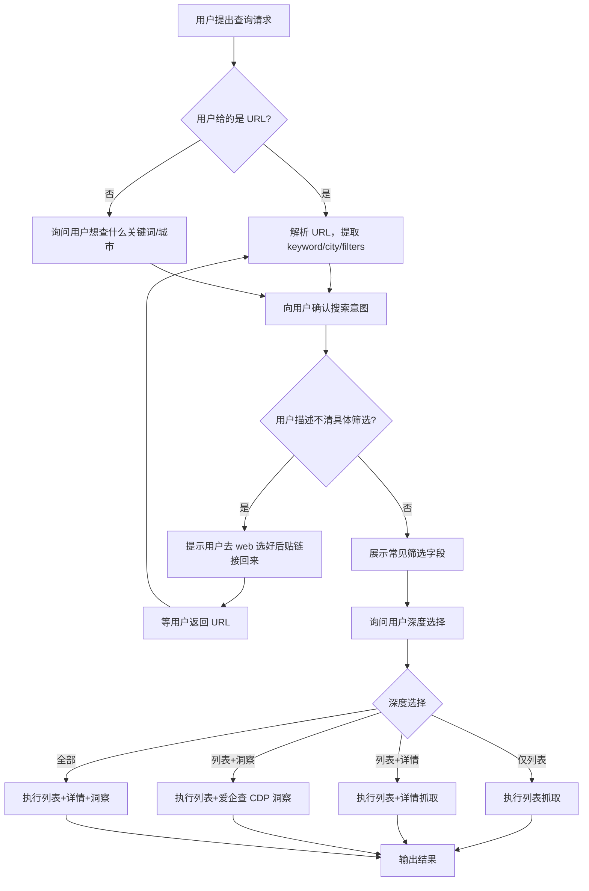

# Task: Pipeline 渐进式询问流程

## 现状问题

当前 SKILL.md Pipeline 章节描述的工作流是：用户给 URL → PipelineState 决策 → 自动跑完整管道。

这存在几个问题：
1. agent 拿到查询请求就闷头跑，不了解用户真实需求
2. 没有引导用户做筛选条件选择
3. 没有让用户选择查询深度，默认全跑
4. 没有说明各步骤的时间代价

## 目标

将 Pipeline 章节改写为"grill-me"风格：先问清楚用户需求，再按需求执行。

## 新流程

### Agent 接到查询请求后的决策流程

### 深度选项说明

| 选项 | 内容 | 估算时间 | 说明 |
|------|------|----------|------|
| 仅列表 | company_list | 1-2 分钟 | 职位名/薪资/公司/地点 |
| 列表+详情 | + company_detail | 3-8 分钟 | 增加融资/规模/主营/官网 |
| 列表+洞察 | + company_insight | 1-3 分钟 | 增加工商/法人/风险信息（CDP 爱企查自爬虫） |
| 全部 | + detail + insight | 5-12 分钟 | 最完整 |

注意：详情和洞察无耦合，可任意组合。

### 常见筛选字段提示

当用户不清楚筛选时，展示：
- 城市：北京/上海/广州/深圳/杭州/成都...
- 薪资：3K以下/3-5K/5-10K/10-20K/20-50K/50K+
- 经验：在校生/应届生/1-3年/3-5年/5-10年/10年+
- 规模：0-20人/20-99人/100-499人/500-999人/1000-9999人/10000+
- 学历：大专/本科/硕士/博士

### CDP 洞察可用性

Pipeline 涉及洞察（爱企查 CDP 自爬虫）时，需 Chrome CDP 在线：
- CDP 可用 → 提供洞察选项
- CDP 不可用 → 跳过洞察分支，不阻塞其他流程

## 改动文件

- `SKILL.md` — Pipeline 章节改为渐进式询问
- `skill/pipeline.md` — 替换"使用方式"和"Agent 快速参考"为询问流程
- `specs/task_skill_progressive_disclosure.md` — 与本次 spec 合并

## 提交

合并为单 commit，包含 skill 拆分 + Pipeline 询问流程优化。
