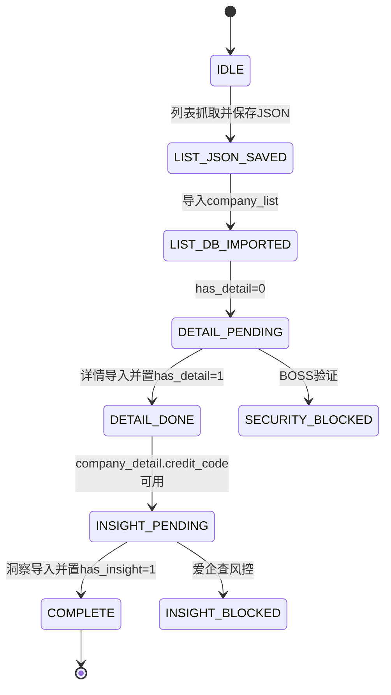
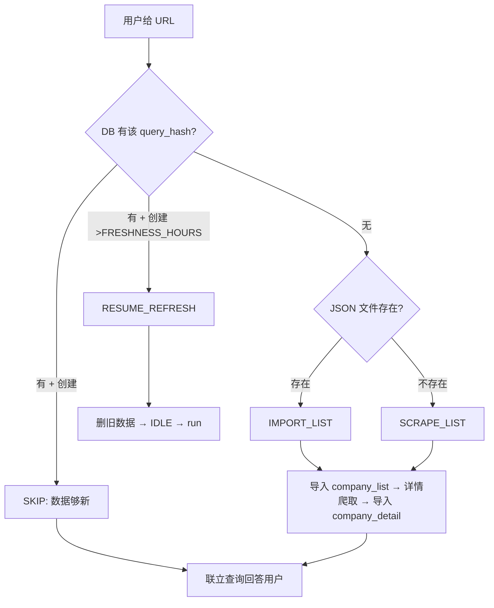
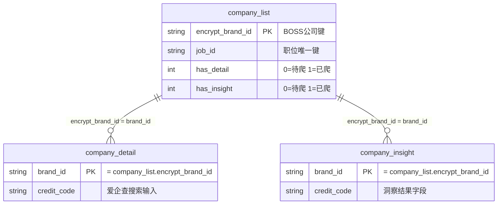

# Task: Pipeline 状态机与统一决策入口

> **当前实现契约（优先于本历史设计记录）**
>
> 当前列表阶段不会把 `credit_code` 写入 `company_list`。真实链路是：
>
> ```text
> list → company_list.encrypt_brand_id → detail → company_detail.credit_code → insight → company_insight
> ```
>
> ```text
> company_list.encrypt_brand_id = company_detail.brand_id
> company_list.encrypt_brand_id = company_insight.brand_id
> company_detail.credit_code → 爱企查搜索输入
> Aiqicha company_id/pageid → 爱企查页面导航标识
> ```
>
> 因此，列表导入后不能直接宣称 detail 和 insight 可以并发；洞察需要详情阶段产生的 `credit_code`。下文中与此契约冲突的早期设计内容均视为已被当前实现取代。

## 目标

新增 `PipelineState` 类作为管线统一决策入口：用户给 URL → 系统自动判断跳过/导入/爬取/刷新 → 按状态机推进到两张表就绪。补充 `db.py` 查询方法，更新 `SKILL.md` 工作流文档。

## 状态流转

```
IDLE → LIST_JSON_SAVED → LIST_DB_IMPORTED → DETAIL_JSON_SAVED → COMPLETE
```

每步独立执行，根据当前状态自动跳过已完成步骤，支持中断恢复。

## 决策流程

用户给 URL 后，`PipelineState.decide()` 自动判断下一步动作：

```
用户给 URL
    │
    ▼
PipelineState.decide()
    │
    ├── DB 有数据且 <FRESHNESS_HOURS → SKIP（数据够新，直接联立查询回答）
    ├── DB 有数据但 >FRESHNESS_HOURS → RESUME_REFRESH（清旧数据，重新爬）
    ├── 无 DB 数据，JSON 文件存在 → IMPORT_LIST（跳过爬取，直接导入）
    └── 什么都没有 → SCRAPE_LIST（从头开始）
```

决策优先级：
1. DB 有数据 → 检查 freshness → 决定跳过或刷新
2. 无 DB 数据，JSON 存在 → 跳过爬取直接导入
3. 什么都没有 → 从头爬取

## 修改 1：`scripts/company_list/db.py` — 补充 3 个查询方法

在 `JobDatabase` 类中新增：

```python
def get_query_info(self, query_hash: str) -> dict | None:
    """查询某批次的元信息。
    返回 {query_hash, job_count, company_count, oldest_create_time,
           detail_done, detail_pending}，不存在返回 None。"""

def get_all_query_hashes(self) -> list[dict]:
    """返回所有已有查询批次的摘要列表。
    每项 {query_hash, keyword, city, job_count, oldest_create_time}。"""

def delete_query(self, query_hash: str) -> int:
    """删除某 query_hash 的全部 company_list 行（用于过期刷新）。
    返回删除的行数。"""
```

## 修改 2：`scripts/company_list/pipeline.py` — 完整重写

### PipelineState 类

```python
"""管道状态机 — 统一决策入口。

用法:
    pipe = PipelineState(query_url="https://...", db=db)
    action = pipe.decide()
    if action != "SKIP":
        result = pipe.run(keyword="AI Agent", city_input="上海")
"""

class PipelineState:
    def __init__(self, query_url: str, db=None, query_hash=None):
        self.query_url = query_url
        self.query_hash = query_hash or compute_query_hash(query_url)
        self.db = db or JobDatabase()
        self.db.connect(); self.db.init_schema()
        self._load_state()

    def _load_state(self):
        """从 DB 和文件系统恢复当前状态。"""
        info = self.db.get_query_info(self.query_hash)
        json_path = os.path.join(QUERY_DIR, f"{self.query_hash}.json")

        if info is None:
            if os.path.exists(json_path):
                self.step = "LIST_JSON_SAVED"
            else:
                self.step = "IDLE"
        elif info["detail_pending"] == 0:
            self.step = "COMPLETE"
        else:
            self.step = "LIST_DB_IMPORTED"

    def decide(self) -> str:
        """决策下一步动作：SKIP / IMPORT_LIST / SCRAPE_LIST / RESUME_REFRESH"""
        info = self.db.get_query_info(self.query_hash)
        if info:
            age = datetime.now() - datetime.fromisoformat(info["oldest_create_time"])
            if age < timedelta(hours=FRESHNESS_HOURS):
                return "SKIP"
            else:
                return "RESUME_REFRESH"
        json_path = os.path.join(QUERY_DIR, f"{self.query_hash}.json")
        if os.path.exists(json_path):
            return "IMPORT_LIST"
        return "SCRAPE_LIST"

    def run(self, keyword=None, city_input=None, filters=None,
            max_pages=3, cdp_port=9222, fmt="json") -> dict:
        """推进管线到 COMPLETE，根据 self.step 自动跳过已完成步骤。
        Returns: {action, query_hash, step, stats, json_path, detail_count}
        """

    def _cleanup_for_refresh(self):
        """过期刷新：删除旧数据，重置到 IDLE。"""
        self.db.delete_query(self.query_hash)
        self.step = "IDLE"

    def _step_scrape_list(self, keyword, city_input, filters, max_pages, cdp_port, fmt):
        """列表爬取 → 保存 JSON。"""

    def _step_import_list(self, json_path=None):
        """导入 JSON → company_list。"""

    def _step_scrape_details(self, cdp_port):
        """扫描 has_detail=0 → 爬取详情 → 保存 JSON。"""

    def _step_import_details(self):
        """导入详情 JSON → company_detail → 更新 has_detail=1。"""
```

### 模块级便捷函数

```python
def query(query_url: str, **kwargs) -> dict:
    """一键入口：给 URL → 得到结果。
    自动决定跳/查/恢复，返回 {action, query_hash, stats}。"""

def print_status():
    """打印所有查询批次状态。"""
```

### 向后兼容

保留旧的 `step1_scrape_list` ~ `step4_import_details`、`run_full_pipeline` 函数不变，`PipelineState` 内部复用。

### 新鲜度配置

从环境变量 `BOSS_QUERY_FRESHNESS_HOURS` 读取（已在 `.env.example` 中定义），默认 24 小时。

```python
FRESHNESS_HOURS = int(os.environ.get("BOSS_QUERY_FRESHNESS_HOURS", "24"))
```

## 修改 3：`scripts/company_list/__init__.py`

新增导出：`PipelineState`、`query`、`print_status`、`FRESHNESS_HOURS`

## 修改 4：`SKILL.md` — 新增管道工作流章节

在「自动化流程」之后插入「管道工作流 (Pipeline)」章节。

### 当前状态图



`company_insight` 的 `brand_id` 通过 `company_list.encrypt_brand_id` 连接；`credit_code` 只作为爱企查搜索输入。
### 决策流程图



### 表关系与联立键



`credit_code` 不是三张表的连接键，爱企查 `company_id/pageid` 也不进入项目三表关系。

```sql
SELECT cl.title, cl.salary, cl.location,
       cd.company_name, cd.stage, cd.scale, cd.description,
       cd.credit_code, ci.legal_person, ci.business_status
FROM company_list AS cl
LEFT JOIN company_detail AS cd
  ON cl.encrypt_brand_id = cd.brand_id
LEFT JOIN company_insight AS ci
  ON cl.encrypt_brand_id = ci.brand_id
WHERE cl.query_hash = 'xxxx'
ORDER BY cl.salary DESC;
```

### Agent 快速参考清单

Agent 接到 URL 后的决策流程：
1. 计算 `query_hash = MD5(url)[:16]`
2. 调 `PipelineState.decide()` 决定动作
3. SKIP → 直接 SQL 联立查询回答
4. IMPORT_LIST → `run()` 从导入开始
5. SCRAPE_LIST → `run()` 从头开始
6. RESUME_REFRESH → 清旧数据后 `run()`
7. 联立键：`company_list.encrypt_brand_id` = `company_detail.brand_id`

### 中断恢复场景表

| 场景 | decide() 返回 | run() 行为 |
|------|--------------|-----------|
| 首次查询 | `SCRAPE_LIST` | 完整执行 step1-4 |
| JSON 已爬未导入 | `IMPORT_LIST` | 跳过 step1，从 step2 开始 |
| 列表在 DB，详情未爬完 | (step=DETAIL) | 跳过 step1-2，从 step3 开始 |
| 全部完成，< FRESHNESS_HOURS | `SKIP` | 不调 run()，直接查 DB |
| 全部完成，> FRESHNESS_HOURS | `RESUME_REFRESH` | 删旧数据后从头 run() |

### 使用示例

```python
# 一键入口
from scripts.company_list.pipeline import query
result = query("https://www.zhipin.com/web/geek/jobs?city=101020100&query=AI Agent")

# 分步控制
from scripts.company_list.pipeline import PipelineState
pipe = PipelineState("https://...")
action = pipe.decide()
if action != "SKIP":
    pipe.run(keyword="AI Agent", city_input="上海")
```

## 不需要修改的文件

- `scripts/boss_cdp_raw.py` — `scrape_list` 签名不变
- `scripts/company_detail/extractor.py` — 不变
- `tests/company_list/test_db.py` — 可选补充新方法的测试
- `.env.example` — 已有 `BOSS_QUERY_FRESHNESS_HOURS=24`

## 验证

- `python -m py_compile scripts/company_list/db.py` — 语法
- `python -m py_compile scripts/company_list/pipeline.py` — 语法
- `python -m unittest tests.company_list.test_db` — DAL 回归
- `python -c "from scripts.company_list.pipeline import query, PipelineState; print('ok')"` — 导入

## 溯源

- Plan 文件：由 Agent 自动生成
- 本 spec：`specs/task_pipeline_state_machine.md`
- CHANGELOG：未发布段落新增条目
