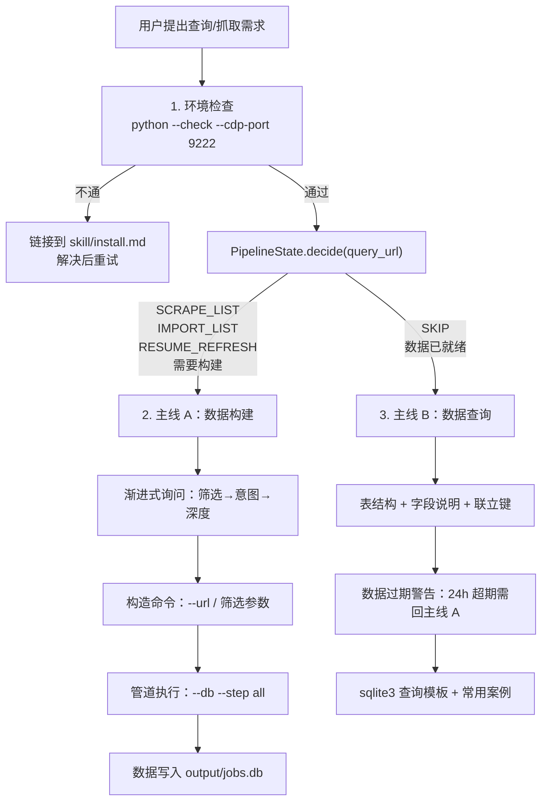

# Task: SKILL.md 双主线重构

> **当前实现契约（优先于本历史设计记录）**
>
> 本文件记录 Skill 双主线重构的历史计划。`company_list` 没有 `credit_code` 列；详情 extractor 从 `business_info` 取统一社会信用代码并写入 `company_detail.credit_code`，爱企查以此搜索，`company_id/pageid` 仅用于页面导航。三表连接键是 `company_list.encrypt_brand_id = company_detail.brand_id = company_insight.brand_id`，空库顺序为 `list → company_list → detail → company_detail.credit_code → insight → company_insight`，不能把 detail 和 insight 写成列表入库后的直接并发。
>
> 当前 `--step all` 总是报错；`PipelineState.decide()` 可能在 `detail_pending>0` 时返回 `SKIP`，`LIST_JSON_SAVED` 下的 `run()` 会再次抓列表，且 URL 入口不注入 `scrape_insight_fn`。这些恢复和入口限制必须在现行说明中显式保留。
>
> **历史记录标记**：下文的结构图、命令和验收标准保留原始重构背景；与当前契约冲突的内容属于原方案（已过时）。

## 现状问题

当前 SKILL.md（`bef6752` 版本）是线性结构：前置条件 → 脚本位置 → 依赖安装 → 自动化流程 → Pipeline → 常见问题。

核心缺陷：
1. **数据构建和数据查询不是平等关系** — SQL 查询藏在 Pipeline 子章节的 agent 询问流程里，agent 打开 SKILL.md 看到命令示例就动手，不走决策判断
2. **没有决策入口** — agent 不知道应该先判断"有没有数据"再决定走哪条路
3. **安装内容占篇幅** — 脚本复制命令和依赖安装占了 SKILL.md 前 1/3，但这些只需首次读取
4. **渐进式询问流程在 pipeline.md 里** — 藏在子文件，agent 压根不看

## 目标

将 SKILL.md 重构为"决策入口 + 双主线"结构：
- **决策入口**：简短的 --check 环境检查 + `PipelineState.decide()` → 决定走哪条主线
- **主线 A：数据构建** — 渐进式询问（内联，不藏子文件）→ 构造命令 → 管道推进
- **主线 B：数据查询** — 表结构/字段 → 数据过期警告 → 查询方法 → 常用案例

两条主线在目录中平级（同级 heading），视觉上等权。安装说明只留一行链接到 skill/install.md。

## 结构设计



## 改动文件清单

### 1. `SKILL.md` — 完全重写

新结构（按顺序）：

```
---
front matter---
version: 2.4.0
platforms: [macos, linux, windows]  ← 补 windows
---

# BOSS直聘职位抓取工具 v2.4
  1 句话简介

## 1. 决策入口（每次必读）
  ### 1.1 环境检查
    python3 "$SCRIPT_PATH" --check --cdp-port 9222
    不通 → 链接 skill/install.md
  ### 1.2 PipelineState.decide() 判断路径
    SKIP → 走主线 B
    其他 → 走主线 A
    返回值速查表

## 2. 主线 A：数据构建（爬虫·管道）
  ### A1 渐进式询问
    展示筛选维度 → 确认意图 → 选择深度
  ### A2 构造命令
    --url 优先 / 筛选参数备选
    命令示例
  ### A3 管道推进
    PipelineState 状态机简述
    链接到 skill/pipeline.md 详细状态机
  ### A4 完成
    数据写入 output/jobs.db

## 3. 主线 B：数据查询（SQL·分析）
  ### B1 表结构
    三张表完整字段列表（从 db.py SCHEMA_SQL 提取）
    联立键：encrypt_brand_id = brand_id
  ### B2 数据过期警告
    ⚠️ BOSS_QUERY_FRESHNESS_HOURS=24h
    超期数据仍在 DB 但需重新走主线 A
  ### B3 查询方法
    Python sqlite3 代码模板
  ### B4 常用查询案例
    薪资分布 / 行业筛选 / 详情进度 / 批次对比
  ### B5 关键索引
    预建索引列表

## 4. 命令速查
  URL 模式 / 分步管道 / 筛选参数 / 输出格式

## 5. 常见问题

## 6. 子模块索引

## 7. 注意事项

## 8. 安装说明
  一行链接 → skill/install.md
```

### 2. `skill/pipeline.md` — 重写为纯技术参考

移除：渐进式询问流程（全部移到 SKILL.md 主线 A）
保留/新增：
- PipelineState 状态机图
- decide() 决策表（返回值 → 动作）
- 中断恢复场景表
- 表关系 ER 图
- 文件路径表

### 3. `specs/task_skill_dual_mainline.md` — 本文件

### 4. `CHANGELOG.md` — 未发布段落新增条目

### 5. `AGENTS.md` — 无需修改

本次重构仅改变 SKILL.md 和 pipeline.md 的组织方式，不改变代码行为或架构。AGENTS.md 中的目录结构和硬规则不受影响。

## 验收标准

- [ ] SKILL.md 决策入口 ≤15 行（不含代码块）
- [ ] 主线 A（数据构建）和主线 B（数据查询）是同级 heading（`##`）
- [ ] 渐进式询问流程内联在主线 A 中，不在 pipeline.md
- [ ] 主线 B 有明确的数据过期警告（24h 超期需回主线 A）
- [ ] pipeline.md 不含 agent 询问流程内容
- [ ] 安装说明在 SKILL.md 中只有一行链接
- [ ] platforms 包含 windows
- [ ] 148 个单测全通过
